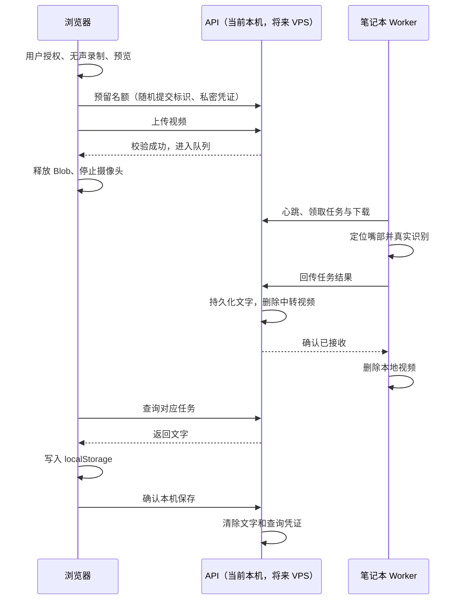

# 网页 Demo：本地运行与实现说明

对应需求：[PRD](product/prd-web-demo.md)；对应设计：[Figma 状态与组件](product/web-demo-figma.md)。

**公网版本已于 2026-10-20 部署到 https://lips.maki3991.xyz**。连接公网中转请运行 `scripts/run_vps_worker.ps1`，详见 [VPS 部署说明](vps-deployment.md)；以下本地启动方式继续保留。

## 本次 Goal

依据用户最新 Figma 文案，实现可以在电脑 localhost 测试、适配手机的网页，以及任务服务和笔记本 Worker；完成本地闭环、异常验证与运行说明。最初 Goal 为本地实现，后续 VPS 部署单独记录。

- 手机采用现有 Figma 流程，不恢复已隐藏的重复副标题。
- 电脑宽度达到 800px 后，录制区与本机记录分为两列；复用同一套颜色、组件和状态，不需要先制作另一套电脑设计稿。
- 桌面程序及原有目录保留，不迁移到 `program/`。

## 在这台电脑启动

目前已安装网页依赖和独立 API 环境。项目根目录的 PowerShell 中运行：

```powershell
.\scripts\run_web_demo.ps1
```

打开 **http://127.0.0.1:8000**，等待右上角从「准备中」变为 **Online**。点击开启摄像头、开始录制、停止录制，预览后点击提交。使用摄像头的应是这个浏览器页面，原桌面程序可以关闭以避免设备占用。

脚本会启动静态网页/API 和模型 Worker，终端显示状态。保持终端打开；按 **Ctrl+C** 一起停止 API、Worker 和模型子进程。网页可在电脑 Chrome/Edge 上使用摄像头，`localhost` 无需先配置 HTTPS。端口被占用时用 `-Port 8001`。

首次安装或重新安装依赖：

```powershell
.\scripts\setup_web_demo.ps1
.\scripts\run_web_demo.ps1
```

要求 Node.js 20.19+ / 22.12+、系统 Python 3.11+ 和已能运行桌面识别的模型环境。API 独立安装到 `.venv-web/`，不改模型环境。固定依赖快照见 `requirements-web.lock.txt`；重建同一依赖组合可用 API Python 安装该文件。

Worker 从 `local.settings.json` 读取 `python` 和 `vsrRoot`。权重沿用桌面程序的 `outputs/mvp/active-model.json` 选择；没有个人权重选择时使用原 CNVSRC 权重。Worker 不启动桌面窗口、录制快捷键或桌面历史记录。

其他入口：

```powershell
# 只开网页/API，检查 Offline 状态
.\scripts\run_web_demo.ps1 -NoWorker

# 页面未改动时跳过构建
.\scripts\run_web_demo.ps1 -NoBuild

# 修改网页时：先启动 API，然后另开终端
cd web
npm.cmd run dev
```

开发服务器显示的 localhost 地址通过 Vite 代理访问 8000 端口的 API。它与 8000 地址是不同 origin，本机记录各自独立。首次构建失败时先运行 setup。启动日志在 `.web-demo/logs/`；模型加载失败看 `worker.events.log`、`worker.stderr.log`，API 看 `server.log`。

## 代码分工

| 目录 | 责任 | 将来放在哪里 |
| --- | --- | --- |
| `web/` | Vite + TypeScript；浏览器摄像头、MediaRecorder、状态、记录、清空确认 | 构建后放 VPS |
| `demo_server/` | FastAPI + SQLite；名额、临时上传、任务认证、结果交接、清理 | VPS，无模型依赖 |
| `laptop_worker/` | 主动通过 HTTP 领取任务；复用 CNVSRC 识别与嘴部定位 | 笔记本模型环境 |
| `.web-demo/` | 本地密钥、SQLite、临时视频、日志；已加入 Git 忽略 | 各自设备的私有运行数据 |
| `tests/web_demo/` | 并发、凭证隔离、清理、真实媒体解码等自动化测试 | 开发环境 |



## 目前采用的参数

| 参数 | 当前值 |
| --- | --- |
| 同时上传 | 2 |
| 上传中 + 等待中 | 合计最多 10；上传预留也占名额 |
| 同时识别 | 1；包含下载、解码、检测与推理 |
| 单条视频 | 10 秒、10,000,000 字节；浏览器目标 640×480、25fps、无音频 |
| 临时视频总预算 | 200,000,000 字节；同时保留至少 100 MB 磁盘余量 |
| 上传预留 | 180 秒过期；浏览器上传超时约 175 秒 |
| 排队 | 最长 30 分钟 |
| 处理 | 最长 300 秒；卡住的模型子进程被终止并重新加载 |
| 心跳 | 每 4 秒；20 秒未收到则 Offline |
| 未确认结果 | 最多 1 小时；确认后立即清除 |
| 清理扫描 | 每 10 秒及相关状态操作、启动时执行 |
| 新提交频率 | 每个来源 IP 每分钟最多 6 次申请；幂等恢复请求也计入 |
| 日志 | API 与 Worker 事件日志各 2 MB × 3 份；启动 stdout/stderr 每次启动覆盖 |

这些值在 `demo_server/store.py` 的 `Limits` 中集中定义，目前只支持一个 API 进程和一个串行 Worker。**不应直接将 Uvicorn 改成多个进程**，否则内存心跳状态不共享。未来增加至 2–3 路需要实现 Worker 池、共享在线状态并重新测吞吐与内存，单改数字不会加速当前串行 Worker。

媒体校验接受浏览器的 WebM/MP4 容器，必须只有一个视频流、没有音频，最少约半秒/12 帧。限制最大单边 1280、总像素 1280×720、解码帧数 650；时长有 0.5 秒封装容差。长视频、异常格式、超出限制的视频在 VPS 阶段删除并标记失败。

## 本机记录和失败行为

浏览器在 `localStorage` 的 `myl.web.task.v1.` 命名空间保存小型 JSON：提交标识、任务 ID、时间、状态、文字；任务未交接时还保存私密查询 token。视频仅在当前页面的 Blob 内存中，**不写 localStorage、IndexedDB 或相册**。浏览器的释放意味着解除应用引用，不承诺系统级立即覆写内存。

页面先把结果存入本机，再向 API 确认。存储不可用时不确认清除服务端结果，会提示复制文字。确认成功后删除本机 token，只保留编号与文字。清空操作需要确认，只移除本站这套命名空间的记录；有任务或结果尚未交接时禁用。普通历史不会到一小时自动消失，用户可以主动清空。

上传响应丢失时先查询原任务；用同一提交标识和 token 可取回同一个任务，避免重复识别。未被完整接收的视频可以重新上传；服务器已标记失败时可在保留预览的当前页面重新提交。**不自动重新运行模型**。刷新会失去未上传 Blob；有效排队/处理任务仍可凭本机 token 恢复。中断上传的预留最多三分钟结束。

识别失败（无嘴部、空输出、模型异常等）会进入明确终态并释放资源；文字识别错属于模型质量问题，仍显示原始结果。模型初始化不成功不会伪造 Online。服务重启会明确结束当时的上传和处理中任务；排队任务保留至等待期限。过期租约不能覆盖已有结果，重复回传相同结果也不会重复入库。

VPS 的结果清除是应用层删除；SQLite 留下不含文字/查询凭证的短期去重墓碑，最多一小时后清理。孤儿视频、部分上传、已结束任务文件都会清理；Windows 文件暂被占用时下一轮重试。Worker 视频正常在回传确认后删除；若长时间无法回传或进程异常，终止/下次启动也清理。模型中间帧只在进程内存，不另存嘴部视频。

## 本轮验证（2026-10-20）

- 前端 TypeScript 检查与生产构建通过。
- API 自动化用例 **9 项通过**，验证原子名额、队列、凭证隔离、格式拒绝、真实 WebM 解码、结果 ACK、超时、重启及孤儿文件清理；Python 静态检查通过。
- 电脑 Chrome 自动化检查 1440px 和 390px 布局、录制/预览/提交、任务刷新恢复、清空禁用与取消/确认，以及离线/准备中/满额界面。状态覆盖仅用于界面测试，不属于真实 Worker 证据。
- 项目既有 `test-videos/1/01_baseline.mp4` 在本机转换为约 5 秒无声 WebM，真实 Worker 完成嘴部预处理与识别；端到端约 **73 秒**、上传约 122 KB。结果成功交接后，查询失效，中转视频删除。原始测试输出在 Git 忽略的 `test-results/web-demo/real-model.json`。这次只验证可运行，**输出文字明显仍有错误，不代表准确率合格**。
- 另用同一人脸视频作为浏览器虚拟摄像头输入，实际执行 MediaRecorder 录制、上传及模型识别；检查成功结果、刷新后本机保存、交接后 token 移除、复制到剪贴板，以及清空后刷新不再恢复。合成摄像头画面另验证了真实模型的「无嘴部」失败分支。
- 测试截图在 Git 忽略的 `test-results/playwright/`；测试用视频与摄像头替身不进入产品逻辑。

以上是本地阶段验证；已完成的公网部署与识别闭环见 [VPS 部署说明](vps-deployment.md)。PRD 全部上线验收还需要 iPhone Safari/Android 真机 HTTPS 测试、实际手机网络传输，以及至少 10 条连续任务与多设备压力/稳定性验证。当前测试摄像头由 Chrome 提供的虚拟视频输入驱动，没有操控用户的真实摄像头。

重新跑后端验证：

```powershell
.\.venv-web\Scripts\python.exe -m pytest tests/web_demo -q
```

## VPS 部署方式

以下是部署原则；当前实例路径、配置与启动命令以 [VPS 部署说明](vps-deployment.md) 为准。

1. 本地 `web/` 构建后，把 `web/dist`、`demo_server` 和 API 环境依赖安装到 VPS；无需模型或桌面 Qt 环境。
2. 给服务设置 `MYL_WORKER_SECRET`（至少 32 字符随机值）、私有 `MYL_DATA_DIR`、`MYL_LOG_DIR`；不要提交或把密钥写进前端。当前 VPS 的 API 绑定 `127.0.0.1:8010`，由 Nginx 提供域名 HTTPS 与反向代理。
3. 代理限制请求体 10 MB、上传超时至少 180 秒，转发真实来源 IP，限制可信代理；日志不记录认证头、请求体、结果或查询 token。接口凭证都在请求头，URL 只有随机任务 ID。
4. 笔记本在模型 Python 中设置相同 `MYL_WORKER_SECRET` 后，运行 `python -m laptop_worker --url https://你的域名`。Worker 主动出站，不需要笔记本公网 IP，也不必与观众同一 Wi-Fi。
5. 手机必须访问 HTTPS；普通局域网 HTTP IP 地址通常无法授权摄像头。正式演示地址为 https://lips.maki3991.xyz。

现有 CNVSRC 上游许可和权重条款仍按 `THIRD_PARTY.md` 与 PRD 中的边界处理；本轮本地实现不改变第三方授权。
